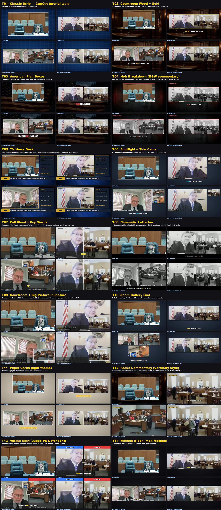

# ⚖️ Court Studio

Courtroom commentary YouTube niche — **ek repo mein sab kuch**:

1. **Library** — 10,981 public court/judge livestream recordings (36 channels), searchable transcripts,
   har video ka topic, judge aur opportunity score.
2. **Desk** — naye court uploads laane ka system (optional: apne computer pe ya apni GitHub copy pe — [UPDATES.md](UPDATES.md)).
3. **Niche breakdown** — 14 competitor channels (3,017 videos) ka analysis, judge live sources, title/thumbnail formulas.
4. **Studio** — video banane ka pipeline: case dhoondo → commentary script → narrator voice → 19 templates mein edit → MP4.



## Students: kaise use karein
1. Repo clone karo aur folder Claude Code mein kholo:
   ```bash
   git clone <repo url>
   cd court-studio
   claude
   ```
2. Claude ko bas likho, misal:
   - *"Judge Simpson ki koi sovereign citizen wali video do"*
   - *"cop ke against koi achha case dhoondo"*
   - *"mujhe suggest karo kya banaun"*
   - *"is case pe T05 template mein 10 min ki video banao"*
3. Claude case dhoondta hai, sirf zaroori hissa download karta hai, script + voice + editing karta hai, aur
   title/description/tags deta hai.

**Updates optional hain** — repo ek snapshot hai, khud update nahi hota. Naye court videos chahiye to
apne computer pe `python3 tools/update.py`, ya apni GitHub copy pe automatic. Poora tareeqa: [UPDATES.md](UPDATES.md).

Setup: `studio/docs/SETUP.md` (python3, ffmpeg, yt-dlp, faster-whisper, edge-tts). Research templates (B01–B05)
ke liye apni free keys `studio/config.env` mein (`config.env.example` dekho).

## Folders
| | |
|---|---|
| `CLAUDE.md` | Claude ke liye instructions (yahi system chalata hai) |
| `tools/find_case.py` | library search: topic / judge / jumla / suggest / hot windows |
| `library/` | `index.csv` + `transcripts/*.jsonl.gz` |
| `desk/` | updater (pipeline + student site) — optional, `UPDATES.md` |
| `tools/update.py` | naye videos apne computer pe laao |
| `niche/` | playbook, competitor report, opportunities, judge sources |
| `studio/` | editing system, templates, docs, example projects |

## Rights
Library sirf public official court feeds ki auto-captions hai. Competitor channels ki sirf metadata/analysis
hai, unki transcripts ya footage nahi. Videos banate waqt court ke recording rules, minors, victims aur
sealed cases ka khayal rakho. Ye legal advice nahi.
